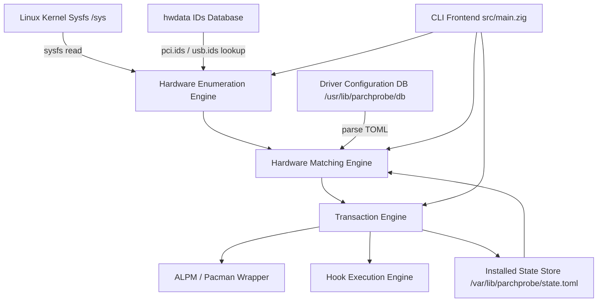

# Architecture of ParchProbe

ParchProbe is the system hardware detection and driver management engine for Parch GNU/Linux. The utility bridges Linux kernel hardware discovery via sysfs, a declarative configuration database, and system package manager transactions through Arch Linux Package Management (ALPM).

## 1. System Overview

The application is structured strictly as a core library with a thin command line interface on top. The core library (`src/lib/`) contains zero terminal formatting and zero unbuffered standard output logic. Every library operation accepts an allocator and returns owned data or explicit errors. This separation allows the engine to be consumed directly by both the native command line tool and external frontends such as the Parch Driver Manager desktop interface.

## 2. Layered Component Architecture

### 2.1 Sysfs Abstraction Layer (`src/lib/sysfs.zig`)

Hardware inspection is implemented directly on top of the Linux virtual filesystem at `/sys`. No legacy C libraries such as libhd or hwinfo are linked. All sysfs queries flow through an explicit `Sysfs` context instance that stores the base path of the sysfs hierarchy. This design permits deterministic testing against mock directory trees without needing root privileges.

PCI devices are enumerated by reading directory entries under `/sys/bus/pci/devices/`. For every device directory, the engine extracts the vendor ID, device ID, class code, and optional subsystem IDs. USB devices are enumerated by walking `/sys/bus/usb/devices/` and reading descriptors from sysfs attributes.

### 2.2 Device Identification Layer (`src/lib/device.zig`, `src/lib/ids.zig`)

Raw hardware devices are represented by the `Device` struct. Each device contains string fields for its bus identifier, class ID, vendor ID, device ID, subsystem vendor ID, subsystem device ID, driver name, and human-readable names.

Human-readable vendor, device, and class strings are resolved through streaming parsers implemented in `ids.zig`. These parsers read the system hardware database files at `/usr/share/hwdata/pci.ids` and `/usr/share/hwdata/usb.ids`. The parser streams line by line without holding the entire multi-megabyte text database in memory, extracting vendor names, device names, and PCI class descriptions on demand.

### 2.3 Configuration Database Layer (`src/lib/config.zig`, `src/lib/db.zig`)

Driver packages and configuration profiles are represented by the `Config` struct. Profiles are stored in declarative TOML files named `PROBECONFIG` located under `/usr/lib/parchprobe/db/`. 

The TOML parser is written as a recursive descent scanner in `config.zig`. It parses top-level driver metadata such as package names, descriptions, priorities, and dependency lists. Furthermore, it parses repeated `[[hardware]]` tables that define the hardware signatures matching that driver. A hardware signature can specify inline hex globs or reference an external file containing lists of supported IDs.

Persistent system state is tracked in `/var/lib/parchprobe/state.toml`. When a driver configuration is installed, the engine serializes the installed driver name, bus type, origin source path, resolved package dependencies, and hook locations into this file. When drivers are removed, the corresponding record is deleted.

### 2.4 Matching Engine Layer (`src/lib/match.zig`)

The matching engine determines which driver configurations are applicable to the hardware detected on the host. A configuration matches a device when its hardware criteria evaluate to true:

1. Blacklist Check: If the device class, vendor, or device ID matches any pattern in the blacklist arrays, the match is rejected immediately.
2. Positive Criteria: The device must match the specified class ID patterns, vendor ID patterns, and device ID patterns.
3. Multi-Group Satisfaction: When a configuration defines multiple `[[hardware]]` groups, all groups must find at least one matching device on the system before the configuration is marked as satisfied. This prevents multi-GPU hybrid configurations from activating on machines that have only an integrated GPU.

Glob matching is case-insensitive and supports wildcard asterisks, single-character question marks, and character class brackets.

### 2.5 Transaction and Hook Execution Layer (`src/lib/tx.zig`, `src/lib/pacman.zig`, `src/lib/hooks.zig`)

Modifying system driver configurations requires root privileges. The transaction engine enforces safe execution through atomic phases:

1. Permission Verification: Non-root executions are rejected before any package operations begin, except in dry-run mode.
2. Conflict Resolution: The engine compares the requested driver against currently installed configurations. If an installed driver matches a pattern in `config_conflicts`, the transaction fails with an explicit conflict error.
3. Dependency Installation: Dependencies declared in `depends` and dynamic kernel dependencies declared in `kernel_depends` are resolved. For kernel dependencies, the engine detects running and installed kernels (such as `linux` or `linux-lts`) and expands prefixes into full package names like `linux-nvidia`.
4. Hook Dispatch: Pre-install and post-install hooks are executed if present in the driver directory. Hooks are passed the normalized bus address and device IDs as positional arguments, with operational context passed through environment variables.
5. State Commitment: Only when all hooks and package manager operations succeed does the engine write updated records to `/var/lib/parchprobe/state.toml`.

## 3. Package Management Integration

Package operations interface with Arch Linux Package Management through two complementary pathways:

| Integration Mechanism | Primary Purpose | Implementation Details |
|---|---|---|
| ALPM C API (`src/lib/alpm/`) | Direct Local Database Query | Uses translated ALPM headers and links against system `libalpm.so`. Queries local package caches, detects installed kernels, and verifies package states without spawning subprocesses. |
| Pacman Subprocess (`src/lib/pacman.zig`) | Root Transactions & Cache Control | Executes `/usr/bin/pacman` with arguments `--noconfirm`, `--needed`, and explicit transaction roots. Captures standard output and standard error, providing reliable permission escalation and sandboxed testing via `--root`. |

## 4. Memory and Concurrency Model

Memory management across the codebase relies on explicit `std.mem.Allocator` passing. Functions never allocate silently on a hidden global heap. All allocated structs provide explicit `deinit(allocator)` methods that recursively release allocated strings and arrays.

The test suite validates memory safety by running all integration and unit tests under `std.testing.allocator`. Any unreleased byte triggers an immediate test failure.
