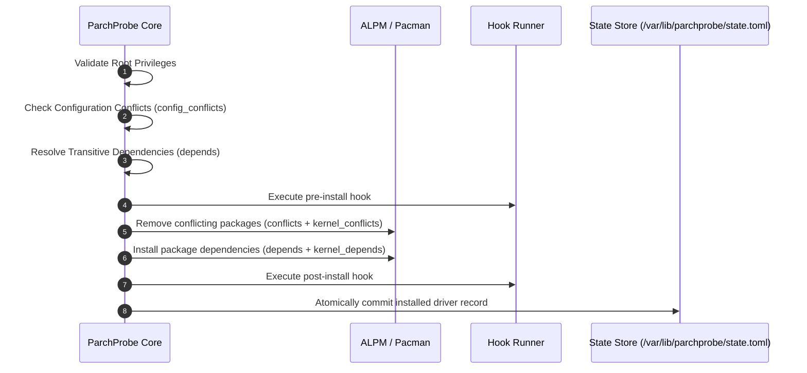

# Transaction Engine and Lifecycle Specification

The ParchProbe transaction engine is responsible for coordinating safe driver installation and removal operations. The engine interfaces directly with Arch Linux Package Management (ALPM), executes configuration lifecycle hooks, and manages persistent driver records.

## 1. Lifecycle Sequence

Driver transactions follow a deterministic sequence of validation, preparation, execution, and commitment steps.



## 2. Validation and Conflict Detection

Before executing package manager transactions or scripts, the engine validates the system state:

1. Privilege Verification: The caller must execute with effective user identifier zero (`root`). When executed as an unprivileged user, the engine immediately aborts with `PermissionDenied`. Transactions executed with `--dry-run` or in testing harnesses with `allow_non_root` bypass this restriction.
2. Duplicate Prevention: Attempting to install an already installed driver raises `AlreadyInstalled`, unless `--force` is specified. With `--force`, the engine performs an implicit removal of the existing profile before proceeding with installation.
3. Profile Conflict Verification: Every pattern in `config_conflicts` is compared against currently registered profiles in `state.toml`. If any pattern matches an installed driver, the transaction is rejected with `ConfigConflict`. This prevents incompatible driver configurations (such as open-source Nouveau and proprietary NVIDIA) from being active at the same time.

## 3. Package Management Operations

ParchProbe handles both static package dependencies and dynamic kernel modules.

### 3.1 Kernel Package Expansion

Modern Linux distributions frequently install multiple kernels side by side, such as `linux`, `linux-lts`, or `linux-zen`. The `kernel_depends` and `kernel_conflicts` arrays specify driver package prefixes rather than static package names.

During execution, ParchProbe inspects the local ALPM database to discover all currently installed packages matching the regular expression `^linux[0-9]*(-.*)?$`. For every detected kernel, the declared prefix is expanded into the full package name formatted as `<kernel>-<prefix>`.

For example, when `kernel_depends = ["nvidia"]` is declared and both `linux` and `linux-lts` are installed on the host system, the transaction expands the required dependencies to `linux-nvidia` and `linux-lts-nvidia`.

### 3.2 Multilib Filtering

On 64-bit x86 architectures, multilib support can be toggled by the system administrator. ParchProbe inspects the system configuration file `/etc/parchprobe-x86_64.conf`. If the file contains the setting `PARCHPROBE_LIB32=false`, all dependencies prefixed with `lib32-` are filtered out of package manager transactions.

## 4. Hook Execution Protocol

Driver profiles can supply custom lifecycle scripts inside the directory specified by `hooks_dir`. The engine supports four distinct execution points:

| Hook Script | Invocation Trigger | Execution Condition |
|---|---|---|
| `pre-install` | Immediately prior to package operations | Only when packages are being installed. |
| `post-install` | Immediately after package installation completes | Validates hardware configuration and creates modprobe files. |
| `pre-remove` | Immediately prior to removing package dependencies | Prepares hardware for fallback driver initialization. |
| `post-remove` | Immediately after package removal completes | Removes residual modprobe blacklists and configuration files. |

### 4.1 Invocation Arguments and Environment

Each hook script must be executable. When invoked, ParchProbe passes positional command line arguments representing the matched devices:

```text
/path/to/hook <CLASSID> <VENDORID> <DEVICEID> <BUSID>
```

The bus ID parameter is normalized to standard PCI notation (such as `01:00.0`) without leading domain zeros. In addition, the engine injects execution context via environment variables:

| Environment Variable | Value Description |
|---|---|
| `PARCHPROBE_CONFIG` | Absolute filesystem path to the `PROBECONFIG` file. |
| `PARCHPROBE_OPERATION` | Either `install` or `remove`. |

If a hook exits with a non-zero exit code, the transaction aborts with a `HookFailed` error.

## 5. State Store Persistence

The persistent record of installed driver profiles is maintained in `/var/lib/parchprobe/state.toml`. This file is updated atomically:

```toml
[[installed]]
name = "video-nvidia"
bus = "pci"
source = "/usr/lib/parchprobe/db/pci/graphic_drivers/video-nvidia"
hooks_dir = "hooks"
depends = ["nvidia-utils", "nvidia-settings", "linux-nvidia"]
conflicts = ["xf86-video-nouveau"]
kernel_depends = ["nvidia"]
kernel_conflicts = ["nvidia-390xx", "nvidia-470xx"]
```

Because the state file records the exact dependencies and origin paths resolved at install time, subsequent `remove` operations can accurately clean up all associated packages and trigger post-removal hooks even if the system package database has changed.
